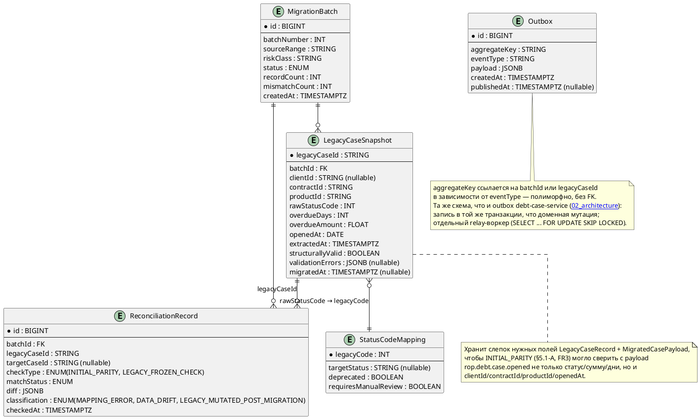
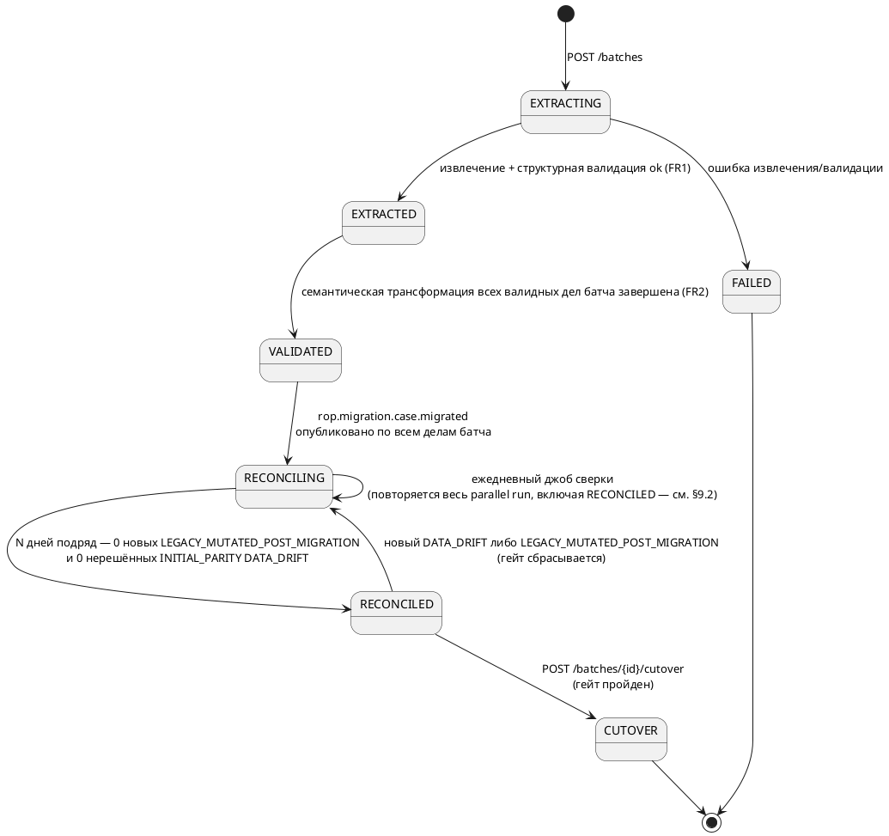
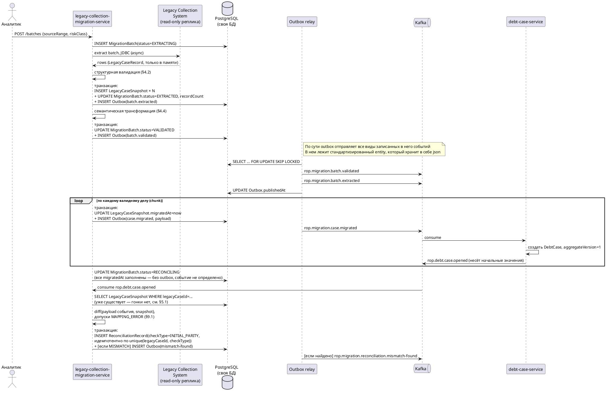
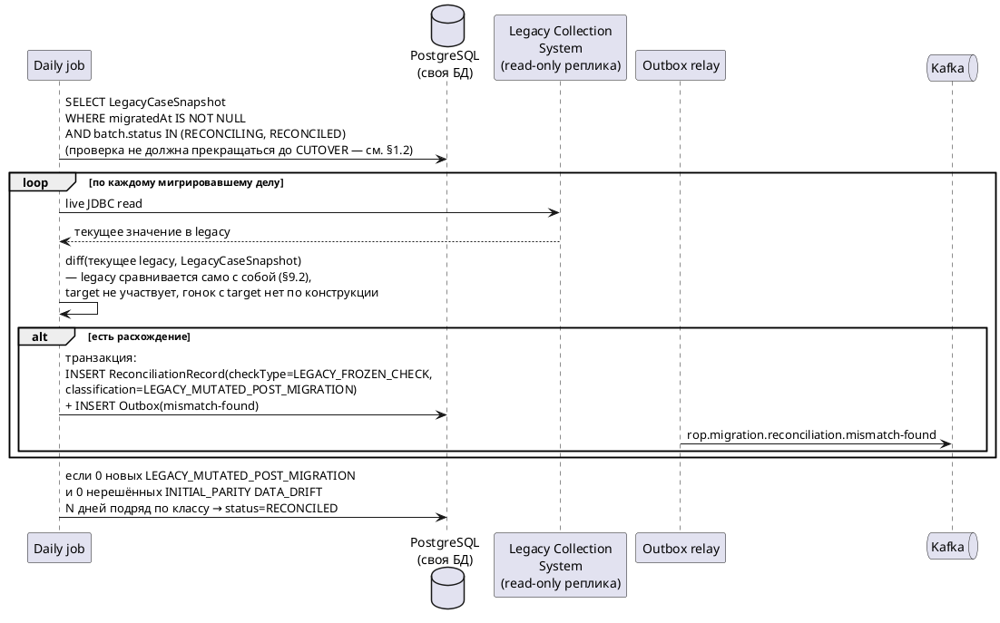
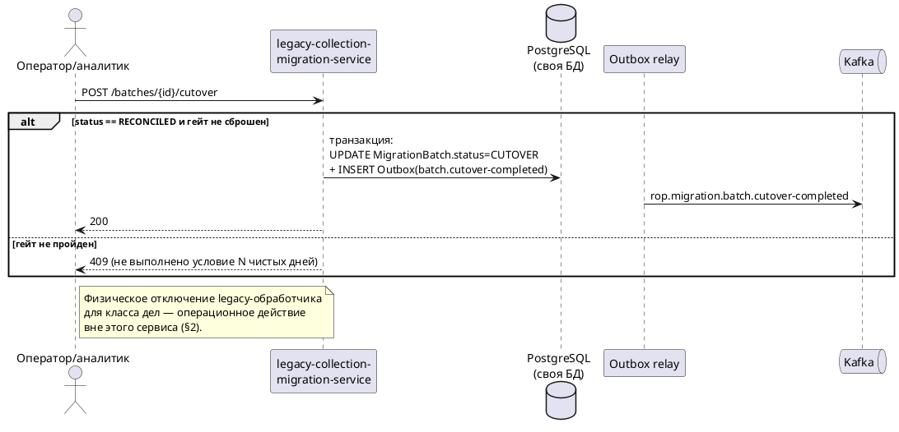
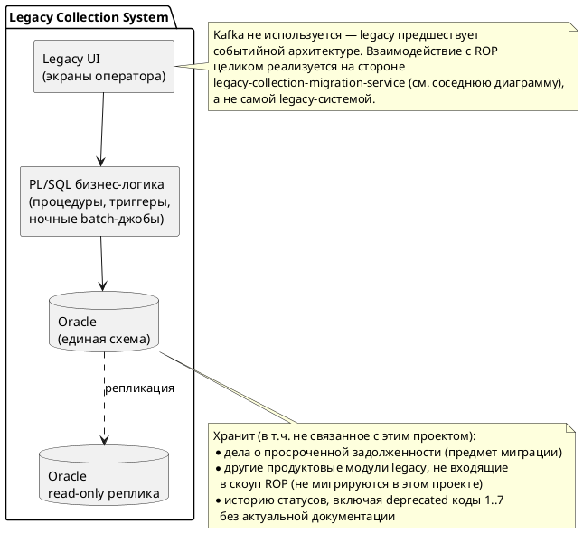
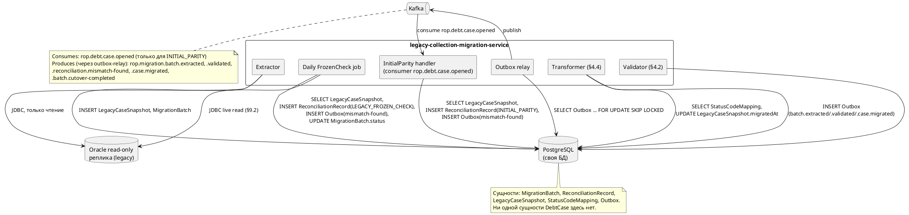

# SDD — legacy-collection-migration-service


## 1. Назначение и жизненный цикл

### 1.1 Почему не одномоментное переключение

«Просто отключить legacy-фронтенд или переподключить его к новому сервису» не рассматривается по трём причинам, не только процессным:

1. **У legacy нет сервисного контракта, который можно переподключить.** Экраны оператора вызывают PL/SQL-пакеты и триггеры напрямую поверх Oracle-схемы. «Переподключить фронтенд» технически равносильно переписыванию всей интеграции разом — тот же big bang, просто сдвинутый на UI-слой.
2. **Oracle-схема legacy не принадлежит только этому проекту.** В ней с высокой вероятностью живут другие модули/продуктовые линии и ночные отчётные джобы, полного реестра потребителей которых у команды миграции нет. Одномоментное отключение доступа к данным рискует сломать неизвестных потребителей.
3. **Юридическая непрерывность.** Часть дел находится в активном исполнительном производстве/переговорах по реструктуризации — жёсткий cutover без накопленных доказательств параметрического соответствия (то есть без периода сверки) означает риск потери непрерывности доказательной базы, если в новой системе обнаружится недокументированное расхождение поведения (например, из-за недокументированных deprecated статус-кодов legacy, см. §8).

Отсюда — поэтапный rollout по классам риска (сначала низкорисковые дела) и параллельный период работы двух систем, подтверждаемый сверкой, а не декларируемый.

### 1.2 Почему legacy продолжает мутироваться после миграции дела

Legacy не проектировалась с возможностью выборочно закрыть доступ к отдельным делам на уровне экрана — доступ у операторов «весь модуль или ничего». В переходный период оператор технически может открыть уже мигрировавшее дело в старом интерфейсе по привычке.

**Это не сценарий синхронизации двух живых систем — это нарушение инварианта** «у мигрировавшего дела ровно один источник истины — целевая система». Сервис миграции переносит `DebtCase` из Legacy Collection System (Oracle) в `debt-case-service` поэтапно, по классам риска, методом **strangler fig**, и всю продолжительность parallel run обязан **обнаруживать** такие нарушения (не «подтягивать» изменения из legacy в целевую систему — обратного sync-пути в архитектуре нет и не планируется, см. §3).

**Это не постоянный домен.** Жизненный цикл сервиса привязан к проекту миграции, а не к бизнес-домену:

```
создание → активная эксплуатация (батчи + ежедневная сверка) → cutover всех классов риска → decommission
```

Критерии и процедура вывода из эксплуатации — §14.

## 2. Границы

**В скоупе:**

- Извлечение батча дел из legacy, структурная валидация, трансформация в целевую схему.
- Публикация факта миграции дела как событие (создание самого агрегата `DebtCase` — ответственность `debt-case-service`, не этого сервиса; см. принцип «нет прямых записей в чужую БД», [[02_architecture#Принципы]]).
- Учёт события `rop.debt.case.opened` — не как watermark, а как источник значения для разовой проверки корректности первичного переноса (`INITIAL_PARITY`, §5.1).
- Ежедневная проверка «legacy не изменилась после миграции» (`LEGACY_FROZEN_CHECK`, §5.1, §9.2) — legacy сравнивается сама с собой, без обращения к target.
- Cutover-гейт: разрешение перехода класса дел на целевую систему только после N дней подряд без новых необъяснённых расхождений.

**Вне скоупа:**

- Запись обратно в legacy — только чтение.
- Ручное исправление данных — сервис публикует необъяснённый остаток расхождений, разбор — задача аналитика/оператора вне этого сервиса (см. риски, §15).
- Физическое отключение legacy-обработчика для класса дел после cutover — операционное действие вне кода сервиса; сервис только формирует событие-разрешение (`rop.migration.batch.cutover-completed`).
- Бизнес-логика мутации `DebtCase` — не дублируется, полностью в `debt-case-service`.

## 3. Функциональные требования

|ID|Требование|
|---|---|
|FR1|Извлечь батч дел из legacy по заданному диапазону, провалидировать **структурно** (не семантически — см. §4), перевести в `EXTRACTED`|
|FR2|Трансформировать каждое валидное дело в целевую схему (семантический маппинг статус-кодов, см. §4 и §8); по завершении трансформации всех валидных дел батча перевести его в `VALIDATED`, затем по каждому делу опубликовать `rop.migration.case.migrated`; создание агрегата — на стороне `debt-case-service`|
|FR3|При получении `rop.debt.case.opened` выполнить `INITIAL_PARITY`: сравнить payload события с `LegacyCaseSnapshot`, записать результат идемпотентно (§5.1, §9.1)|
|FR4|Ежедневный batch-джоб: для каждого мигрировавшего дела (`LegacyCaseSnapshot.migratedAt IS NOT NULL`), пока батч не в `CUTOVER`/`FAILED` (проверка продолжается и в `RECONCILED` — см. §1.2, §9.2, §11), выполнить `LEGACY_FROZEN_CHECK` — сравнить текущее live-чтение legacy с сохранённым снимком на момент экстракции (§5.1, §9.2), не обращаясь к target|
|FR5|Авто-классифицировать каждое расхождение по правилам своей проверки (§9): для `INITIAL_PARITY` — `MAPPING_ERROR` (детерминированная известная причина) либо `DATA_DRIFT` (неизвестная/непредсказанная); для `LEGACY_FROZEN_CHECK` — всегда `LEGACY_MUTATED_POST_MIGRATION` (мутация legacy после миграции, см. §1.2, §9.2; допуски `MAPPING_ERROR` здесь не действуют). Опубликовать в `rop.migration.reconciliation.mismatch-found` только необъяснённый остаток — `DATA_DRIFT` и `LEGACY_MUTATED_POST_MIGRATION`, не `MAPPING_ERROR`|
|FR6|Разрешить `cutover` для класса дел только если N дней подряд — 0 новых `DATA_DRIFT` **и** 0 новых `LEGACY_MUTATED_POST_MIGRATION` по всем делам класса; ручной cutover без выполнения условия — отклонить (409)|
|FR7|Отдать отчёт по расхождениям батча (`GET .../reconciliation-report`) с фильтрацией по дате и `matchStatus`|

## 4. Контракты extraction: структурная валидация vs семантическая трансформация

Это два разных, намеренно разделённых шага — их смешение и было источником путаницы в первой версии документа.

- **Структурная валидация** отвечает на вопрос «можно ли вообще разобрать эту запись» — до того, как мы пытаемся понять её бизнес-смысл. Ловит NULL там, где не должно быть, битую кодировку ФИО, ссылки на несуществующего клиента, отрицательные `overdueDays`. Работает по одной записи, не зная ничего про целевую схему.
- **Семантическая трансформация** отвечает на вопрос «что эта корректно устроенная запись означает в терминах целевой модели» — маппинг числового статус-кода legacy в `DelinquencyStatus`, приведение `FLOAT` к `BigDecimal` с явным rounding mode. Работает уже поверх структурно валидных записей.

### 4.1 Сырой контракт legacy (то, что реально приходит из Oracle)

```java
// То, что физически лежит в Oracle-таблице дела — почти без семантики,
// числовые коды, FLOAT-суммы, нет aggregateVersion (в legacy такого понятия нет вовсе).
public record LegacyCaseRecord(
        String legacyCaseId,
        String clientId,          // может быть NULL — осиротевшая запись
        String contractId,
        String productId,
        Integer rawStatusCode,    // 1..7, часть — deprecated, без документации
        Double overdueAmountRaw,  // Oracle FLOAT, без гарантии rounding mode
        Integer overdueDaysRaw,   // считан ночной batch-джобой legacy, только рабочие дни
        LocalDate openedAtRaw
) {}
```

### 4.2 Структурная валидация (шаг FR1)

```java
public final class LegacyRecordValidator {

    public ValidationResult validate(LegacyCaseRecord r) {
        var errors = new ArrayList<String>();
        if (isBlank(r.legacyCaseId())) errors.add("legacyCaseId отсутствует");
        if (isBlank(r.clientId())) errors.add("clientId отсутствует — осиротевшая запись");
        if (r.rawStatusCode() == null) errors.add("rawStatusCode отсутствует");
        if (r.overdueDaysRaw() != null && r.overdueDaysRaw() < 0) errors.add("overdueDays отрицательный");
        if (r.openedAtRaw() == null) errors.add("openedAt отсутствует");
        // Намеренно НЕ проверяем здесь: известен ли rawStatusCode в StatusCodeMapping —
        // это семантика, а не структура. Неизвестный, но синтаксически валидный код
        // должен дойти до трансформации и быть явно помечен needsManualReview.
        return errors.isEmpty() ? ValidationResult.ok() : ValidationResult.failed(errors);
    }

    private boolean isBlank(String s) { return s == null || s.isBlank(); }
}
```

Запись, не прошедшая структурную валидацию, не идёт дальше — она не является «делом с неизвестным статусом», она вообще не является интерпретируемым делом. Такие записи не увеличивают `recordCount` батча и уходят в отдельный список на ручной разбор аналитиком (не в `ReconciliationRecord` — сверять ещё нечего).

### 4.3 Целевой контракт события (то, что реально уходит в Kafka)

```java
// Payload rop.migration.case.migrated — конверт со schemaVersion/eventType/occurredAt
// оборачивается на уровне publisher'а, здесь только бизнес-часть.
public record MigratedCasePayload(
        String legacyCaseId,
        String clientId,
        String contractId,
        String productId,
        String targetStatus,        // enum DelinquencyStatus, не число
        BigDecimal overdueAmount,   // явный rounding mode применён здесь, не на стороне consumer'а
        Integer overdueDays,
        LocalDate openedAt,
        String batchId
) {}
```

### 4.4 Семантическая трансформация (шаг FR2)

```java
public final class LegacyToTargetTransformer {

    private final StatusCodeMappingRepository mappingRepo;

    public TransformResult transform(LegacyCaseRecord r, String batchId) {
        var mapping = mappingRepo.findByLegacyCode(r.rawStatusCode());

        if (mapping.isEmpty() || mapping.get().deprecated() || mapping.get().requiresManualReview()) {
            // Никогда не домапливаем "на всякий случай" — см. §8: неизвестный/deprecated
            // код всегда уходит на ручной разбор, а не auto-guess.
            return TransformResult.needsManualReview(
                    r, "статус-код %d не имеет подтверждённого маппинга".formatted(r.rawStatusCode()));
        }

        var payload = new MigratedCasePayload(
                r.legacyCaseId(),
                r.clientId(),
                r.contractId(),
                r.productId(),
                mapping.get().targetStatus(),
                BigDecimal.valueOf(r.overdueAmountRaw()).setScale(2, RoundingMode.HALF_UP),
                r.overdueDaysRaw(),
                r.openedAtRaw(),
                batchId
        );
        return TransformResult.ok(payload);
    }
}
```

Разница схем в одной таблице — почему это не «то же самое, просто другой формат»:

|Поле|Legacy|Целевая система|
|---|---|---|
|Статус|`INT` (1..7, часть deprecated, недокументировано)|`String`-enum `DelinquencyStatus`, конечный явный набор значений|
|Сумма долга|`FLOAT`, усечение до 2 знаков, rounding mode не гарантирован|`BigDecimal`, `HALF_UP` явно применяется при трансформации|
|Просрочка в днях|считается ночной batch-джобой, только рабочие дни|real-time, календарные дни|
|Версионирование изменений|отсутствует|`aggregateVersion`, монотонный счётчик|
|Идентификация|`legacyCaseId` (внутренний ключ Oracle)|`caseId` целевой системы, назначается `debt-case-service` при создании агрегата из `rop.migration.case.migrated`|

## 5. Доменная модель, и почему в ней нет ни `TargetCaseProjection`, ни `CaseWatermark`

### 5.1 Два разных вопроса, которые раньше были смешаны в один daily-джоб

Первая версия дизайна сравнивала «legacy» с «текущим состоянием `debt-case-service`» **ежедневно и бесконечно**. Это некорректно: после миграции target — живая система, по делу приходят легитимные события (платежи, реструктуризация), значения меняются законно. Сравнение «legacy на момент экстракции» vs «target сегодня» гарантированно даёт ложные расхождения при первом же платеже.

Правильных проверки — две, с разной периодичностью и разным назначением:

**A. `INITIAL_PARITY` — разовая проверка корректности первичного переноса.** Не джоб, а обработчик события `rop.debt.case.opened`: сравнивается payload этого конкретного события (то, что `debt-case-service` реально создал) с `LegacyCaseSnapshot`. Гонки нет — `LegacyCaseSnapshot` уже существует к этому моменту (записан до публикации `case.migrated`, которая и породила создание агрегата), а `case.opened` — не «текущее состояние, которое можно не успеть прочитать», а конкретное неизменяемое событие. Здесь применяются допуски `MAPPING_ERROR` из §9.

**B. `LEGACY_FROZEN_CHECK` — ежедневная проверка «legacy не трогали после миграции» (§1.2).** Live-чтение legacy сегодня сравнивается с `LegacyCaseSnapshot` на момент экстракции — **legacy сравнивается само с собой**, target не участвует вообще, и значит гонка с эволюционирующим target по конструкции невозможна. Любое расхождение здесь однозначно означает нарушение инварианта «единственный источник истины», а не проблему маппинга — отдельная классификация `LEGACY_MUTATED_POST_MIGRATION`, не `DATA_DRIFT`.

**`CaseWatermark` в этой схеме не нужен** — он пытался решить проблему «подождать затишья перед сравнением с target», а живая система по определению никогда не затихает навсегда. С ним снимается и подписка на `rop.debt.case.status-changed` (нужна была только для обновления watermark) — остаётся только `rop.debt.case.opened`, потребляемый один раз на дело для проверки A.

### 5.2 `LegacyCaseSnapshot` — не то же самое, что была `TargetCaseProjection`

Разница принципиальная. `TargetCaseProjection` была **живым зеркалом**, обязанным оставаться синхронизированным с постоянно меняющимся источником — отсюда и гонки. `LegacyCaseSnapshot` — **замороженный факт на момент экстракции**, не обязанный ничему соответствовать в динамике. Он нужен ровно для двух вещей, для которых нужна именно история, а не live-чтение: проверки A (разовое сравнение с тем, что реально создал `debt-case-service`) и B (детектирование, что legacy кто-то трогал уже после миграции — без сохранённого снимка это физически нечем ловить, доступа к change-log самого legacy у сервиса нет).

### 5.3 ERD

![[Pasted image 20260906185926.png]]



`LegacyCaseSnapshot`, `StatusCodeMapping`, `Outbox` — внутренние таблицы реализации, не выносятся как доменные агрегаты в C4-модель [[03_services]] (не публикуются как контракт наружу).

## 6. Состояния `MigrationBatch`

![[Pasted image 20260906101609.png]]

(расшифровка картинки):



## 7. API

|Метод|Путь|Назначение|
|---|---|---|
|`POST`|`/api/v1/migration/batches`|Создать батч (`sourceRange`, `riskClass`), запускает FR1 асинхронно|
|`GET`|`/api/v1/migration/batches/{id}`|Статус батча|
|`GET`|`/api/v1/migration/batches/{id}/reconciliation-report?date=&matchStatus=`|Отчёт по расхождениям|
|`POST`|`/api/v1/migration/batches/{id}/cutover`|Инициировать cutover; `409`, если гейт (FR6) не пройден|

Внешняя зависимость на batch-`GET` к `debt-case-service`, добавленная в предыдущей редакции, снята вместе с `CaseWatermark` — сверка `INITIAL_PARITY` использует payload уже потребляемого события, `LEGACY_FROZEN_CHECK` вообще не обращается к target (§5.1).

## 8. Контракты событий

**Consumes** (единожды на дело, не как watermark — источник значения для проверки `INITIAL_PARITY`, см. §5.1):

- `rop.debt.case.opened`

**Синхронно вызывает:** ничего на стороне `debt-case-service` в рамках сверки не требуется — проверка `INITIAL_PARITY` использует payload события напрямую; проверка `LEGACY_FROZEN_CHECK` сравнивает legacy само с собой. Единственный синхронный вызов сервиса — `GET /api/v1/migration/batches/{id}` и `.../reconciliation-report`, которые вызывают _у него_, а не он у кого-то

**Produces** (конверт со `schemaVersion`, `eventType`, `occurredAt` — конвенция [[02_architecture#Совместимость схем]]):

|Топик|Ключевые поля payload|
|---|---|
|`rop.migration.batch.extracted`|`batchId`, `recordCount`, `sourceRange`|
|`rop.migration.batch.validated`|`batchId`, `validRecordCount`, `rejectedRecordCount`|
|`rop.migration.case.migrated`|`legacyCaseId`, `targetCasePayload{clientId,contractId,productId,status,overdueAmount,overdueDays}`, `batchId`|
|`rop.migration.reconciliation.mismatch-found`|`batchId`, `legacyCaseId`, `targetCaseId` (nullable для `LEGACY_FROZEN_CHECK`), `diff`, `classification=DATA_DRIFT \| LEGACY_MUTATED_POST_MIGRATION`|
|`rop.migration.batch.cutover-completed`|`batchId`, `riskClass`, `consecutiveCleanDays`|

## 9. Алгоритм классификации расхождений

Две независимые проверки (§5.1), с разной периодичностью и разными правилами.

#### 9.1 `INITIAL_PARITY` — payload `rop.debt.case.opened` vs `LegacyCaseSnapshot`

Правило по умолчанию — `DATA_DRIFT` (fail-safe: неизвестное расхождение никогда не проглатывается молча). В `MAPPING_ERROR` переводятся только 2 задокументированных источника систематической, предсказуемой разницы, с конфигурируемыми порогами:

|Источник|Условие авто-классификации `MAPPING_ERROR`|Иначе|
|---|---|---|
|`overdueDays`: legacy считает по рабочим дням ночным батчем, target — real-time по календарным|`|diff|
|`overdueAmount` округление: legacy `FLOAT` с усечением, target `BigDecimal HALF_UP`|`|diff|
|Статус-код legacy `1..7`, включая deprecated без документации|**Никогда не авто-классифицируется** — `StatusCodeMapping.requiresManualReview=true` для любого не подтверждённого маппинга|всегда ручной разбор|
|Пороги утверждаются комплаенс/аналитиком при постановке (см. [[05_team_structure]] — комплаенс-гейт), не решением разработчика в одиночку.|||

### 9.2 `LEGACY_FROZEN_CHECK` — live-чтение legacy vs `LegacyCaseSnapshot`

Здесь допуски `MAPPING_ERROR` **не применяются** — сравниваются одни и те же сырые legacy-поля сами с собой, никакого day-counting/rounding-разрыва в этом сравнении в принципе быть не может. Любое расхождение = `LEGACY_MUTATED_POST_MIGRATION`, всегда уходит на ручной разбор (§1.2: это индикатор нарушения инварианта «один источник истины», а не дефект переноса — реакция другая: не чинить маппинг, а выяснять, почему в legacy до сих пор есть доступ на запись по уже мигрировавшему делу).

**Race-окно в момент cutover** (платёж на границе переключения) — отдельно не детектируется этим алгоритмом: это состояние снимка ровно в момент, когда обе системы имеют право на кратковременное расхождение по конструкции. Обрабатывается процессно — cutover не должен планироваться на момент известной пиковой активности по классу дел; если расхождение всё же попало в `LEGACY_FROZEN_CHECK` вблизи даты cutover, разбирается вручную с учётом времени платежа, не автоматической эвристикой.

## 10. Нефункциональные требования

- **Объём.** Базовая нагрузка ручной сверки до автоматизации — ~400 дел/неделю; за весь проект миграции — ориентир 40 000+ дел. Ежедневный джоб сверки должен укладываться в ночное окно (часы, не десятки минут на весь объём активных `RECONCILING`-дел).
- **Отсутствие SLA на латентность** — фоновый/batch-сервис, не пользовательский путь.
- **Наблюдаемость.** Алертинг по: батчам, зависшим в `RECONCILING` дольше ожидаемого; росту `mismatchCount`; возрасту необработанных `DATA_DRIFT`-записей.
- **Аудируемость.** Каждое решение классификатора и каждый cutover — событие в `rop.audit.event` (юридически значимый домен, §11 исходного архитектурного документа).
- **ПДн.** `LegacyCaseSnapshot` содержит те же категории ПДн, что и `DebtCase` — те же меры: field-level encryption, маскирование в непрод (§11.7 исходного архитектурного документа).

## 11. Сценарии (sequence diagrams)

#### ExtractionAndInitialParity

![[Pasted image 20260906192039.png]]

(расшифровка картинки):



#### DailyFrozenCheck

![[Pasted image 20260906191131.png]]

(расшифровка картинки):



#### CutoverGate

![[Pasted image 20260906191543.png]]

(расшифровка картинки):



## 12. Обработка отказов

- Ошибка извлечения/валидации батча целиком → `FAILED`, admin-retry (создание нового батча с тем же `sourceRange` после устранения причины).
- Частичный сбой трансформации отдельных дел внутри батча → не роняет батч; такие дела не публикуются в `rop.migration.case.migrated`, остаются вне `recordCount` успешных, попадают в отдельный список для ручного разбора (расширение отчёта FR7).
- Дублирующая/повторная доставка `rop.debt.case.opened` → безопасна: запись `ReconciliationRecord(checkType=INITIAL_PARITY)` идемпотентна по `unique(legacyCaseId, checkType)`, повторная доставка — no-op.
- Сбой outbox-relay (Kafka временно недоступна) → события остаются в `Outbox` с `publishedAt IS NULL`, релей ретраит; доменное состояние (`MigrationBatch`/`LegacyCaseSnapshot`) уже зафиксировано в той же транзакции, что и запись в outbox, — публикация не блокирует прогресс пайплайна.
- Гейт cutover сбрасывается (`RECONCILED → RECONCILING`) при любом новом `DATA_DRIFT`/`LEGACY_MUTATED_POST_MIGRATION`, даже если батч уже был близок к cutover — не допускается «зачёт» старых чистых дней при новом расхождении.

## 13. БД, брокер и границы сервисов

### 13.1 Собственная БД сервиса миграции

**PostgreSQL** (единообразно с остальными сервисами ROP — [[06_tech_stack]]). Хранит: `MigrationBatch`, `ReconciliationRecord`, `LegacyCaseSnapshot`, `StatusCodeMapping`, `Outbox`. Никаких данных `DebtCase` в этой БД не персистируется — только выписки/снапшоты legacy и собственные результаты сверки.

### 13.2 Прямое чтение Oracle — осознанное и ограниченное по времени жизни исключение

Сервис миграции читает legacy **напрямую по JDBC из read-only реплики** Oracle — это единственное место во всей системе, где нарушается принцип «сервисы не читают чужую БД напрямую» ([[02_architecture#Принципы]]). Обоснование, почему это допустимо именно здесь:

- Legacy Collection System не получит инвестиций в отдельный экспорт-API — она подлежит полному decommission, строить для неё чистый контракт ради процесса, который сам себя упразднит, не оправдано.
- Чтение — только с реплики, не с продовой транзакционной БД, чтобы не создавать нагрузку/блокировки на боевые операции legacy.
- Исключение существует ровно на срок жизни сервиса миграции (§1) — оно не создаёт прецедента для постоянных сервисов домена.

Запись обратно в legacy не производится никогда.

### 13.3 Три диаграммы компонентов

![[Pasted image 20260906192115.png]]

(расшифровка картинки):



![[Pasted image 20260906192137.png]]

(расшифровка картинки):



![[Pasted image 20260906192225.png]]

(расшифровка картинки):

```plantuml
@startuml DebtCaseServiceComponents
skinparam componentStyle rectangle
component "debt-case-service" as debt {
  component "Command handlers\n(REST + saga inbox)" as cmd
  component "Outbox relay" as outbox
}
database "PostgreSQL\n(своя БД)" as pg
queue "Kafka" as kafka
participant "legacy-collection-\nmigration-service" as mig
participant "restructuring-workflow-service" as wf
participant "Оператор" as op

op --> cmd : PATCH /debt-cases/{id}/status\n(operator path)
kafka --> cmd : consume rop.debt.restructuring.cmd.*\n(saga path, через inbox)
kafka --> cmd : consume rop.migration.case.migrated
kafka --> cmd : consume rop.risk.overdue-signal.detected
kafka --> cmd : consume rop.legal.hold.*
cmd --> pg
pg --> outbox : SELECT ... FOR UPDATE SKIP LOCKED
outbox --> kafka : rop.debt.case.opened, .status-changed,\n.payment-received,\nrop.debt.restructuring.evt.newTermsApplied
kafka --> mig : mig consume'ит rop.debt.case.opened\n(единственная связь двух сервисов)

note bottom of pg
  Сущности: DebtCase, RestructuringWorkflowLock,
  inbox-таблица (commandId), outbox-таблица.
  Сервис миграции не читает и не пишет в эту БД
  напрямую вообще — единственная связь двух
  сервисов — Kafka, в обе стороны (§13.4).
end note
@enduml
```

### 13.4 Ответ на прямой вопрос про границы чтения/записи

Сервис миграции читает Oracle legacy напрямую (JDBC, read-only реплика, обоснование в §13.2) — это единственное прямое чтение чужой БД во всей системе. В сторону `debt-case-service` он **не читает и не пишет напрямую вообще** — раньше в этом месте был `GET /debt-cases/batch`, но с переходом на модель §5.1 (`INITIAL_PARITY` через payload события, `LEGACY_FROZEN_CHECK` без обращения к target) необходимость в этом синхронном вызове отпала: единственная связь двух сервисов — потребление `rop.debt.case.opened` через Kafka.

## 14. Вывод из эксплуатации и архивирование

Критерий: все классы риска прошли `CUTOVER`, legacy-обработчик отключён операционно для всех классов.

### 14.1 Что архивируется, откуда и кем

Архивация выполняется **самим сервисом миграции**, как обработчик на его же событие `rop.migration.batch.cutover-completed` (внутренний шаг, не отдельный сервис) — сразу после подтверждения cutover конкретного батча/класса риска, не откладывается до полного вывода сервиса из эксплуатации:

|Что архивируется|Источник|Зачем|
|---|---|---|
|Финальная запись `MigrationBatch`|своя PostgreSQL|Факт и параметры миграции батча|
|Полная история `ReconciliationRecord` по батчу (не только финальный статус — все ежедневные прогоны)|своя PostgreSQL|Доказательная база «параметрическое соответствие проверялось N дней подряд», а не декларация постфактум|
|`LegacyCaseSnapshot` на момент последней успешной сверки перед cutover|своя PostgreSQL|Chain of custody: что именно было в legacy на момент, когда было принято решение о cutover|
|Решения классификатора с обоснованием (`MAPPING_ERROR` / `DATA_DRIFT` / `LEGACY_MUTATED_POST_MIGRATION`, применённые пороги)|своя PostgreSQL|Проверяемость автоматических решений постфактум (см. риск в §15)|

**Куда:** объектное хранилище (S3), не та же реляционная БД — согласуется с общим паттерном хранения холодных юридически значимых артефактов в проекте (тот же принцип, что и для чекпоинтов `document-generation-engine`). Ключ: `migration-archive/{riskClass}/{batchId}/manifest.json` + связанные файлы. Формат — самоописывающийся JSON со `schemaVersion` (не бинарный дамп БД), чтобы архив был читаем спустя годы независимо от того, жива ли ещё сама БД сервиса.

**Кто ещё участвует:** после записи в S3 сервис публикует запись в `rop.audit.event` со ссылкой на архив — это даёт `audit-logging-service` возможность указать на архив миграции при комплаенс-запросе по конкретному делу, даже после полного decommission сервиса миграции (см. §14.2). Срок хранения архива — тот же режим retention, что и для `rop.audit.event` в целом (типично 5–7+ лет, §11.6 исходного архитектурного документа), то есть заведомо дольше срока жизни самого сервиса.

### 14.2 Порядок вывода из эксплуатации

1. Убедиться, что для всех классов риска в S3 есть архив (§14.1) и в `rop.audit.event` — ссылки на него.
2. Отключить consumer-группы на `rop.debt.case.opened`.
3. Вывести сервис и его PostgreSQL-БД из эксплуатации. Топики `rop.migration.*` не удаляются немедленно — сохраняются retention-политикой брокера как дополнительная (не единственная) точка постфактум-аудита; основной источник правды для аудита после decommission — S3-архив, не Kafka-retention.

## 15. Риски и открытые вопросы

|Риск/вопрос|Комментарий|
|---|---|
|Точный формат `sourceRange` не определён в исходной документации|Диапазон ID дел? Диапазон дат открытия? Требует уточнения на этапе постановки конкретного батча — не решается на уровне SDD|
|`LEGACY_FROZEN_CHECK` — ежедневный live-JDBC-опрос legacy по всем `RECONCILING`-делам|Нагрузка на read-реплику Oracle растёт с объёмом дел в parallel run; требуется согласование допустимой частоты/размера выборки с владельцами Legacy Collection System, не только с владельцами `debt-case-service` (последняя зависимость снята — см. §13.4)|
|`INITIAL_PARITY` не переоценивается повторно|Если `debt-case-service` изменит логику создания агрегата из `rop.migration.case.migrated` уже после того, как часть дел прошла эту проверку, старые `ReconciliationRecord` не будут пересчитаны автоматически — нужен ручной триггер пересчёта при значимых изменениях на стороне `debt-case-service`|
|Пороги `MAPPING_ERROR` — плейсхолдеры|Нужно утверждение комплаенс/аналитика перед первым боевым батчом, не хардкодить в коде — хранить как конфигурацию с историей изменений (аудит порогов)|
|Риск маскировки реальных дефектов автоклассификацией|Даже корректно настроенный классификатор может со временем скрывать новый вид расхождения под старую причину. Рекомендация: периодическая выборочная ручная проверка случайной подвыборки записей, классифицированных как `MAPPING_ERROR`|
|Механизм доступа к legacy подтверждён как read-only реплика (§13.2), но конкретный SLA репликации (лаг) не определён|Если лаг реплики велик, легаси-снапшот на момент сверки может быть устаревшим относительно самой legacy — нужно зафиксировать допустимый лаг с владельцами Legacy Collection System|